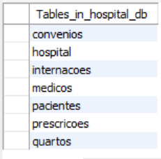

# Projeto_hospital

A tabela apresentada faz parte do banco de dados do sistema de gerenciamento hospitalar, desenvolvido utilizando o MySQL. Ela foi criada para organizar e armazenar informações importantes do hospital, facilitando o cadastro, a consulta e o gerenciamento dos dados.

Cada coluna representa uma informação diferente, como identificadores, nomes, datas e outros dados necessários para o funcionamento do sistema. A chave primária (PRIMARY KEY) serve para identificar cada registro, enquanto as chaves estrangeiras (FOREIGN KEY) permitem relacionar essa tabela com outras tabelas do banco de dados.

Dessa forma, a tabela ajuda a manter as informações organizadas, facilita a realização de consultas SQL e evita a repetição desnecessária de dados.
